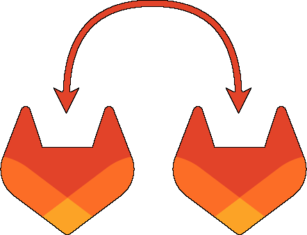

# gitlab-sync




[](https://github.com/boxboxjason/gitlab-sync/releases)


(golang) CLI tool to synchronize GitLab projects and groups between two GitLab instances.
It is designed to be used in a CI/CD pipeline to automate the process of keeping two GitLab instances in sync.

## Features

- Synchronize projects / groups between two GitLab instances
- Recreates your git repository content in another location:
  - Enable Pull Mirroring for projects (requires GitLab Premium)
  - Clone the repository content from the source GitLab instance to the destination GitLab instance (on GitLab Free), optionally caching the clones on disk so the next run only fetches what changed
- Can add projects to CI/CD catalog (requires GitLab 19.3+ on the destination instance)
- Full copy of the project (description, icon, topics,...). Can also copy issues

## Documentation

📖 **<https://boxboxjason.github.io/gitlab-sync/>**

The documentation covers [installation](https://boxboxjason.github.io/gitlab-sync/docs/installation/), every [command line argument and environment variable](https://boxboxjason.github.io/gitlab-sync/docs/usage/), the [mirror mapping file](https://boxboxjason.github.io/gitlab-sync/docs/mapping/) and the behavior on [freemium destinations](https://boxboxjason.github.io/gitlab-sync/docs/freemium/). It is built from the [`docs`](./docs) directory of this repository, so it is updated together with the code.

## Quick start

Install the latest release:

```bash
go install github.com/boxboxjason/gitlab-sync@latest
```

Or use the container image:

```bash
docker pull ghcr.io/boxboxjason/gitlab-sync:latest
```

Then describe what to synchronize in a JSON mapping file, and run:

```bash
gitlab-sync \
  --source-url https://gitlab.example.com \
  --source-token <source_gitlab_token> \
  --destination-url https://mycompany.example.com \
  --destination-token <destination_gitlab_token> \
  --mirror-mapping /path/to/mirror.json
```

Add `--dry-run` to see what would change without writing anything.

## Development

Check the [CONTRIBUTING.md](./CONTRIBUTING.md) file for guidelines on how to contribute to this project, including how to work on the documentation.
